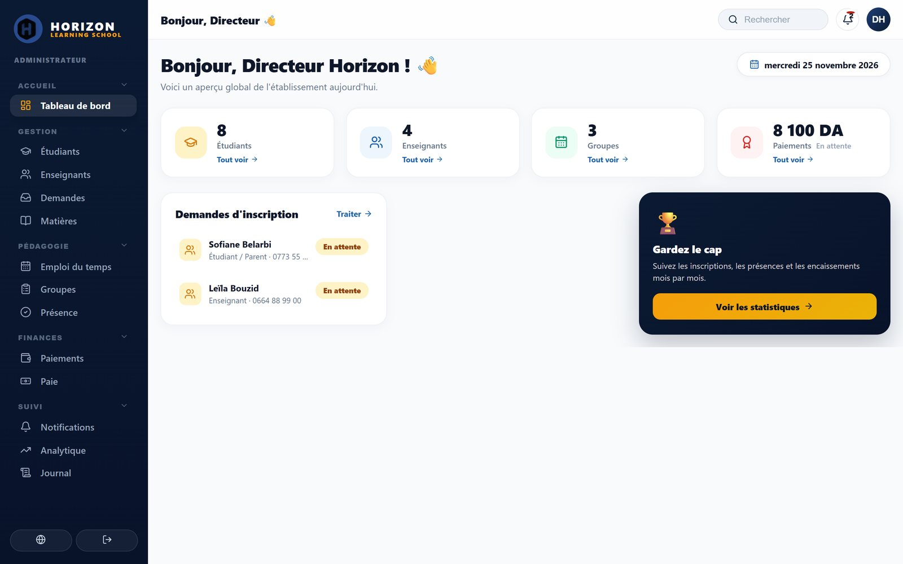
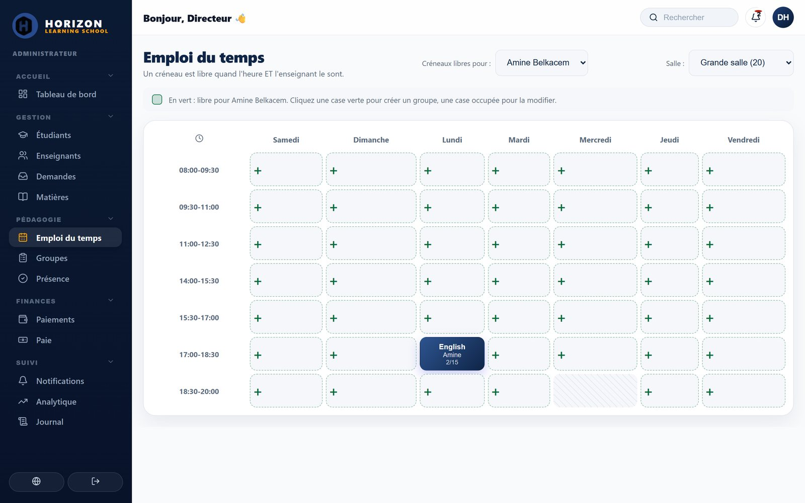
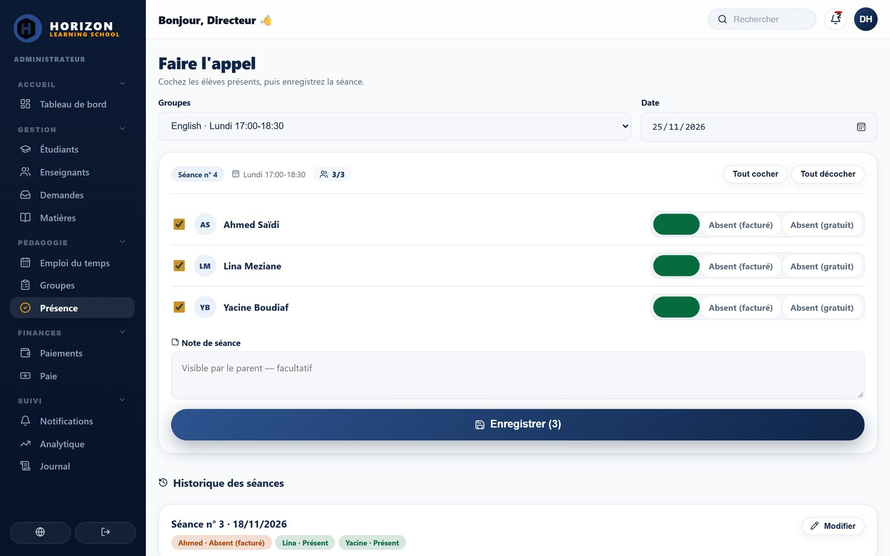
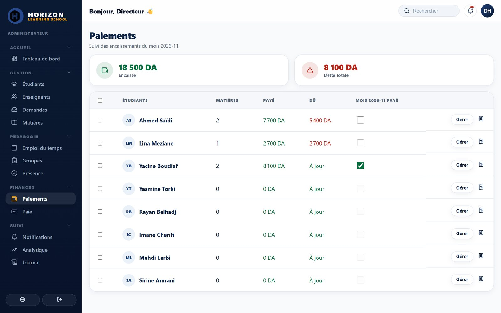
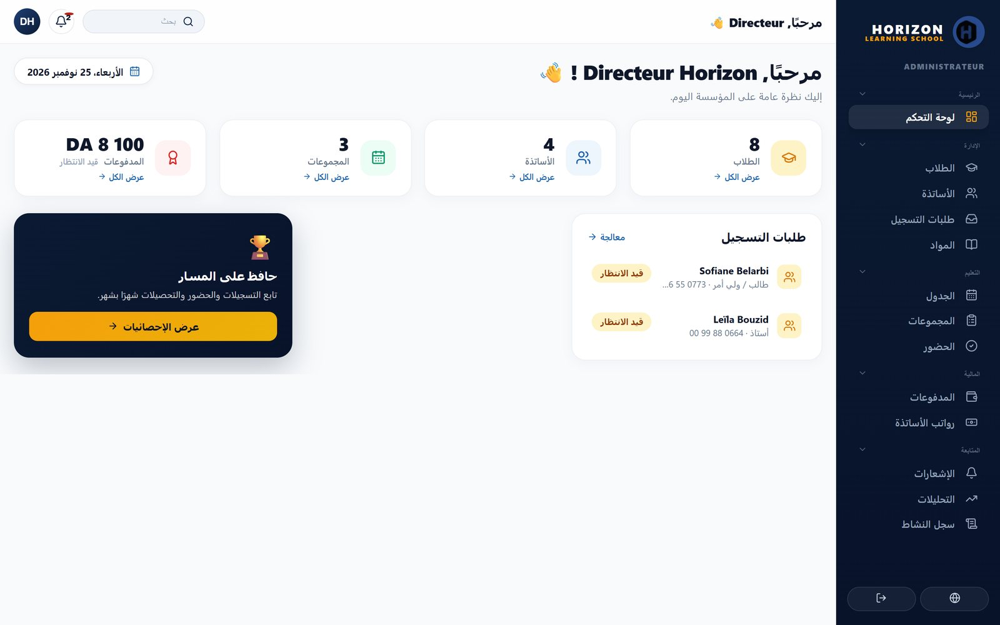

# Horizon Skills Academy

School management app for **Horizon Skills Academy**, a language and tutoring center in Constantine, Algeria. It replaces paper registers and spreadsheets with one tool for the three people who use it every day: the director, the teachers and the students.

Built with **Tauri 2, React 19, TypeScript and Supabase**, so a single codebase ships as a desktop app for the office, a mobile app and a web app (PWA). Arabic is the default language, with a full right-to-left layout; French and English are one click away.


## Features

**Enrollment and accounts**
- Public landing page with the school's programs, methods and contact details
- Students and teachers sign up themselves; the admin approves or refuses each request (e-mail notification on decision)
- Role-based access: admin, teacher and student each get their own space and navigation

**Teaching**
- Subjects, levels (Algerian school years) and groups
- Weekly timetable that only offers slots where both the room and the teacher are free, with room capacity and conflict checks
- Attendance in three states (present, absent and billed, absent and free), with a session note visible to parents and an editable history

**Money**
- Payment engine that follows each session: what every student owes, month by month
- Each fee split between the school and the teacher, as a percentage or a fixed amount
- Grouped invoices, teacher payroll and a "month paid" status visible to the teacher

**Running the school**
- Role-based dashboards built on live data, analytics (revenue per month, per subject, school share per teacher) and an activity log
- In-app notifications: daily digest, payment reminders, slot requests

**Reliability**
- Offline-first: every action updates a local store instantly, then syncs through an outbox
- Real-time sync with Supabase and Row Level Security on every table
- Automatic backup of the data to a Google Sheet
- Demo mode: with no backend configured, the whole app runs on realistic sample data

## Screenshots

| Admin dashboard | Timetable |
|---|---|
|  |  |
| **Attendance** | **Payments** |
|  |  |

Arabic, right-to-left (default language):



## Tech stack

| Layer | Technology |
|---|---|
| App shell | Tauri 2 (Rust): desktop, Android / iOS and PWA from one codebase |
| Front end | React 19, TypeScript, Vite, React Router |
| State | Zustand store, offline outbox |
| Back end | Supabase: Postgres, Auth, Realtime, Row Level Security, pg_cron |
| i18n | i18next: Arabic (RTL), French, English |
| Integrations | Google Sheets backup (Apps Script), EmailJS |
| Validation | Zod |

## Getting started

```bash
npm install
npm run dev          # web app on http://localhost:1420 (demo mode by default)
npm run tauri dev    # native desktop app
npm test             # rules, store, attendance, i18n and a full-month journey
npm run build        # type-check + production build
```

To connect a real backend, copy `.env.example` to `.env`, fill in your Supabase project URL and anon key, then run the SQL files in `supabase/` as described in [DEPLOY.md](DEPLOY.md). Without those two variables the app stays in demo mode.

Android: `npm run tauri android init`, then `npm run tauri android dev`.

## Project structure

```
src/
  app/          app shell, protected routes, navigation per role
  features/     one folder per feature: auth, registration, students, teachers,
                subjects, schedule, sessions, attendance, payments, payroll,
                notifications, analytics, activity, dashboard, discover, courses
  data/         Zustand store, Supabase sync, demo seed
  lib/          pure logic (payments, schedule, permissions), types, i18n, config
  locales/      ar.json, fr.json, en.json
  layouts/      public and app layouts
supabase/       schema, migrations, RLS hardening, automation, Apps Script
src-tauri/      Tauri (Rust) project
tests/          test suites run in demo mode
```
